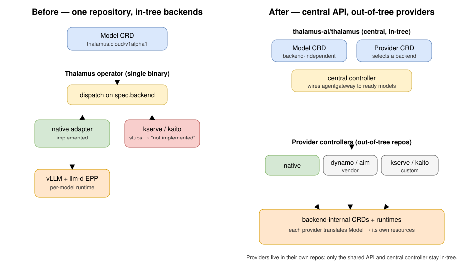
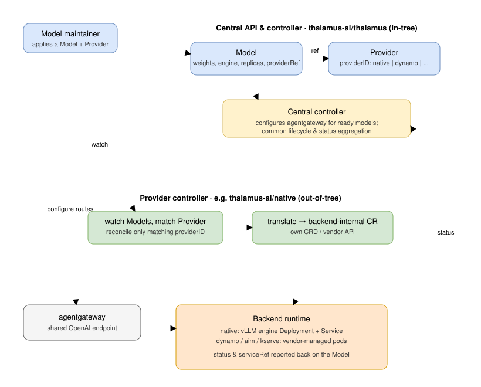

# Backend Hackathon: An Out-of-Tree Provider Architecture

In November 2026 the Thalamus team ran an internal hackathon together with the
[IronCore](https://github.com/ironcore-dev) team to tackle one of the oldest promises in the project: supporting
**multiple inference backends**. Thalamus has always claimed to be vendor-neutral, but so far only the native
backend — vLLM behind the llm-d Endpoint Picker — has actually existed in-tree. Every other backend named by the
API was a stub that failed reconciliation. This hackathon was about turning that promise into an architecture.

A big thank-you goes to the **IronCore team** for their guidance. Their experience building Kubernetes-native
infrastructure APIs was invaluable: they helped us think through the CRD design, pushed back where our abstractions
were leaking, and shared hard-won lessons ("culprits") from running their own provider-style controllers in
production. The collaboration was exactly the kind of cross-team exchange these events are made for.

## The problem: one promise, one backend

Thalamus exposes a single declarative `Model` resource and reconciles it into a complete serving runtime. That part
works well. The trouble was the *shape* of multi-backend support. In the original design the operator was a single
binary that dispatched on a `spec.backend` field:

- `native` was implemented.
- `kserve` and `kaito` were accepted by the schema but returned "not yet implemented".

Adding a real backend this way means adding its adapter, its resource builders, its dependencies, its RBAC, and its
tests **into the central repository**. That is fine for one backend we own. It does not scale to the backends we
actually want to support:

- **Vendor backends** such as NVIDIA Dynamo or AMD AIM.
- **Custom backends** such as KServe or KAITO.

The Thalamus team does not want to own — or be on the hook to maintain and secure — an implementation for every one
of those. Carrying all of them in-tree would turn the project into a permanent adapter farm and drag the public API
toward a lowest-common-denominator shape. We needed a seam that lets other teams (and vendors) ship a backend
**without touching the central repository**.

## The idea: a central API with out-of-tree providers

The architecture we landed on splits the system into two clearly separated responsibilities:

1. **A central API and controller**, in-tree, the same for every backend. It owns the user-facing CRDs and the
   common plumbing — most importantly wiring the inference gateway to the models that are ready to serve.
2. **A provider**, one per backend, that lives **out-of-tree** in its own repository. A provider is just a dedicated
   controller: it watches the central `Model` resources assigned to it and translates them into whatever internal
   CRD or vendor API its backend understands.



The comparison is the clearest way to see the shift. On the left, every backend is an adapter compiled into one
operator binary. On the right, the central repository shrinks to a stable API plus a common controller, and each
backend becomes an independent controller that can be developed, released, and operated on its own schedule — by the
team that actually knows that backend.

> For the hackathon everything lived in-tree in a single repository for convenience. The `native` provider sits in a
> `native/` sub-module with its own `go.mod`, which is the in-tree stand-in for what will become a separate
> `thalamus-ai/native` repository. The split is a packaging detail; the architecture is what matters.

## New primitives: `Model` and `Provider`

Two CRDs in the `core.thalamus.cloud/v1alpha1` group carry the whole contract.

The **`Model`** is still the backend-independent description of what to serve — weights, engine image, replicas — but
it now points at a provider through a `providerRef` instead of a `spec.backend` enum:

```yaml
apiVersion: core.thalamus.cloud/v1alpha1
kind: Model
metadata:
  name: my-qwen
spec:
  replicas: 2
  weights: hf://qwen/qwen3.8-27B
  weightsPullSecretRef:
    name: my-secret
  engine:
    image: docker.io/vllm/vllm-openai:v0.27.0
    args:
      - --tensor-parallel-size=2
      - --reasoning-parser=qwen3
  providerRef:
    name: my-provider
status:
  phase: Running        # Pending | Running | Inactive | Failed
  serviceRef:
    name: my-qwen-engine
  conditions:
    - type: Ready
      status: "True"
      reason: Ready
      message: Engine Deployment is ready
```

The **`Provider`** is the new seam. It is a cluster-scoped resource whose `providerID` names the backend that should
handle any `Model` referencing it:

```yaml
apiVersion: core.thalamus.cloud/v1alpha1
kind: Provider
metadata:
  name: my-provider
spec:
  providerID: native
```

This indirection is the entire trick. The central API never has to know what backends exist. A provider controller
is responsible for recognising "its own" providers and ignoring everything else. In the native provider that check
is a few lines at the top of the reconcile loop:

```go
provider := &v1alpha1.Provider{}
if err := r.Get(ctx, client.ObjectKey{Name: model.Spec.ProviderRef.Name}, provider); err != nil {
    return ctrl.Result{}, client.IgnoreNotFound(err)
}
if provider.Spec.ProviderID != "native" {
    return ctrl.Result{}, nil   // not ours — let another provider handle it
}
```

Because any number of provider controllers can watch the same `Model` and `Provider` resources, adding a backend is
now purely additive: deploy another controller that claims a `providerID`. Nothing in the central repository changes.

## How a model flows through the new architecture



1. A maintainer applies a `Model` (referencing a `Provider`) and the `Provider` itself.
2. The **out-of-tree provider controller** for that `providerID` picks up the `Model`, reconciles it into
   backend-internal resources, and reports status back onto the `Model`. In the native provider that means building a
   vLLM engine `Deployment` and `Service`, mirroring the hardened pod spec Thalamus already used — non-root,
   read-only root filesystem, dropped capabilities, startup/readiness probes on `/v1/models`, and an `hf://` weights
   source expanded into the vLLM command line.
3. The **central controller**, watching `Model` status, configures the shared **agentgateway** so that every model
   reporting `Ready` is reachable through the one OpenAI-compatible endpoint — the common task that every backend
   needs and none of them should reimplement.

The division of labour is the point: the provider knows how to *run* a model; the central controller knows how to
*expose* it. A vendor backend such as Dynamo or AIM, or a custom one such as KServe or KAITO, only has to implement
step 2. Step 3 is free.

## Collaboration and culprits

The most valuable part of the week was the design conversation with the IronCore team. A few things they steered us
away from:

- **Don't leak backend concepts into the central `Model`.** Early drafts had the `Model` carrying backend-specific
  hints. IronCore's experience was that once that starts, the "neutral" API drifts toward one backend's worldview.
  The `Provider` indirection keeps the `Model` honest.
- **Make ownership explicit.** A provider must only ever touch resources it created. The native provider refuses to
  delete anything it does not control via `metav1.IsControlledBy`, which prevents one provider from stepping on
  another's — or a user's — resources.
- **Status is a contract, not a side effect.** Because the central controller drives the gateway purely off `Model`
  status, every provider has to report readiness honestly and consistently. We settled on a single normalised
  `Ready` condition plus a coarse `phase`, so the central side never has to understand backend internals.

These are the kinds of "culprits" that are obvious only after you have operated this pattern — exactly why the
exchange with IronCore was worth more than any amount of solo design time.

## Why old-vs-new, and not just the new picture

We deliberately kept the before/after comparison in this post. The new diagram on its own explains *what* we built,
but the value of the change only lands when you see *what it replaces*: a single binary that had to grow a new
adapter, dependency set, and test surface for every backend. The comparison makes the architectural payoff — a small
stable core plus independently shippable providers — immediately visible. The only argument against showing both is
space, and in a design post about a structural change we think the contrast earns its place.

## What's next

This was a hackathon, so what we have is a working skeleton, not a finished architecture:

- **Verify the architecture and decide how to proceed.** The first step is to review what we built, confirm the
  central-API-plus-out-of-tree-provider approach holds up, and identify the issues we knowingly left out during the
  hackathon - then decide on the shape of the real implementation in an ADR.
- **Extract the providers into their own repositories.** The `native` provider is already isolated as its own module;
  the next step is to move it (and a first vendor provider) out of the central repo entirely, proving the out-of-tree
  story end to end.
- **Firm up the `Provider` contract.** We want providers to advertise their capabilities and configuration
  (accelerator profiles, defaults) rather than the central side assuming equivalence between backends.
- **A second real backend.** The architecture is only validated once a non-native backend — Dynamo, AIM, KServe, or
  KAITO — reconciles a `Model` through the same seam. That is the milestone that turns "multiple backends" from a
  promise into a feature.

Thanks again to the IronCore team for the guidance on Kubernetes API design and the candid exchange on the culprits
they have already hit. It made the result considerably better than it would otherwise have been.
